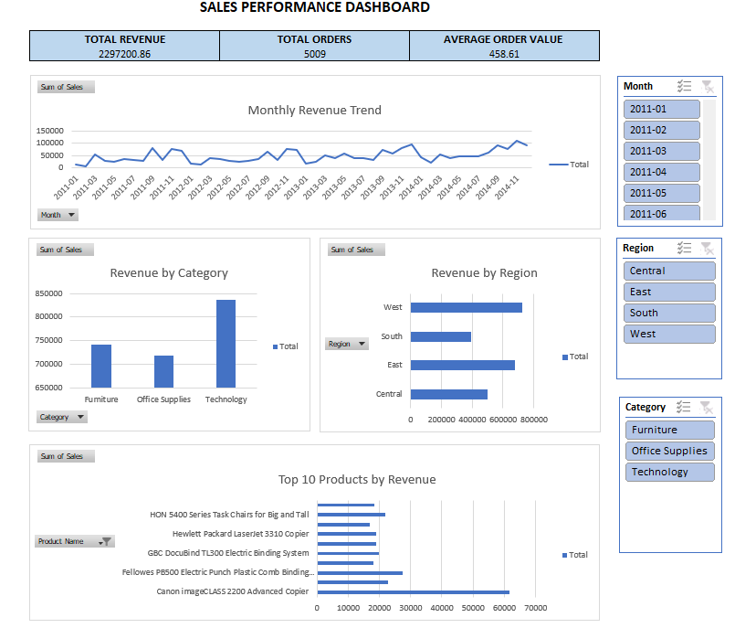
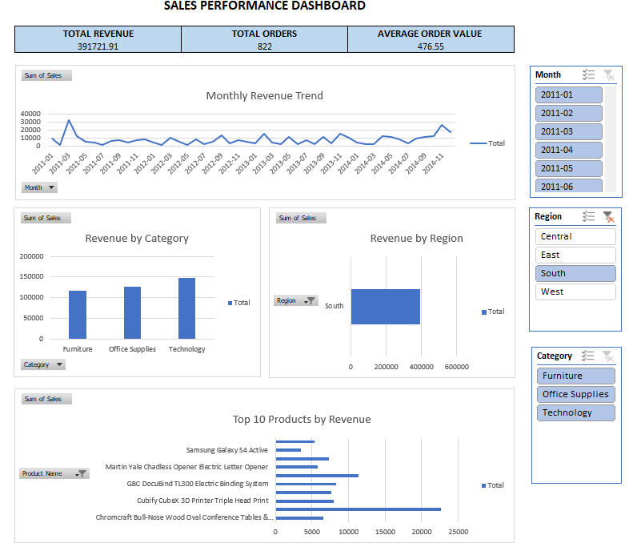
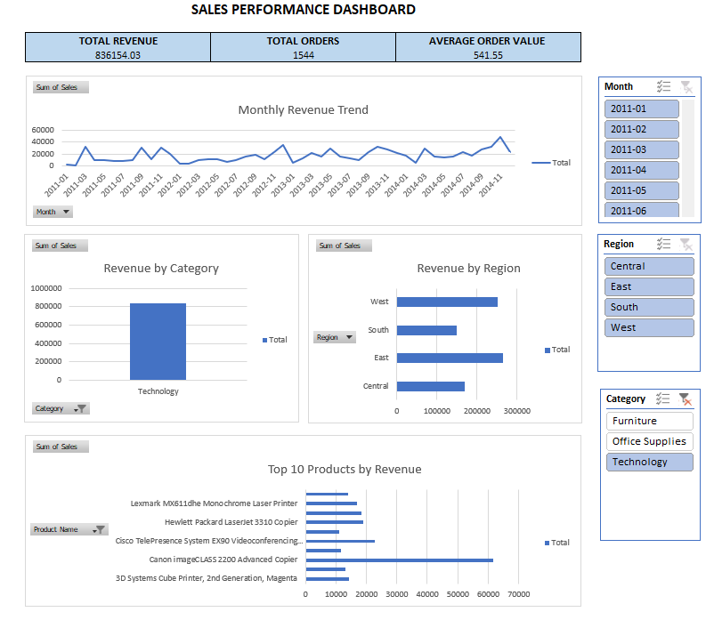

# Sales Performance Analytics Dashboard

An end-to-end sales analytics project using Python, MySQL, and Microsoft Excel to analyze sales performance, identify business trends, and present actionable insights through an interactive dashboard.

## 1. Business Problem

Businesses need to understand their sales performance across different time periods, regions, product categories, and individual products. This project analyzes sales transaction data to track key performance indicators (KPIs), identify sales trends, and support data-driven business decisions.

## 2. Dataset

- **Source:** Kaggle CSV dataset.
- **Dataset type:** Superstore-style sales transaction data.
- **Records:** 9994 rows in the original dataset.
- **Columns:** 22.
- **Key fields:** Order ID, Order Date, Ship Date, Region, Category, Sub-Category, Product Name, Sales, Quantity, Discount, and Profit.

The dataset contains sales and order information that can be analyzed to understand product, regional, and time-based performance.

## 3. Tools and Technologies

- **Python:** Data cleaning, exploratory data analysis, and validation.
- **Pandas:** Data manipulation and analysis.
- **Matplotlib and Seaborn:** Data visualization.
- **MySQL:** SQL queries and sales KPI calculations.
- **Microsoft Excel:** PivotTables, PivotCharts, KPI cards, and interactive slicers.
- **Jupyter Notebook:** Executing and documenting the analysis.
- **Git and GitHub:** Version control and project publishing.

## 4. Project Workflow

1. Imported and inspected the sales dataset.
2. Cleaned and prepared the data for analysis.
3. Performed exploratory data analysis using Python.
4. Queried sales data using MySQL.
5. Validated aggregate KPI calculations between Python and MySQL.
6. Built an interactive Excel dashboard with KPI cards, PivotCharts, and slicers.
7. Interpreted the results and developed business recommendations.

## 5. Key Performance Indicators

The following values were calculated using the full dataset during validation:

 Total Revenue - 2,297,201.07 
 Total Orders - 5,009 
 Average Order Value - 458.61 

## 6. Key Findings

The analysis focuses on the following areas:

- **Monthly sales performance:** Understand how revenue changes over time.
- **Regional performance:** Compare sales contributions across regions.
- **Category performance:** Identify which product categories generate the most revenue.
- **Product performance:** Identify the top 10 products by sales.
- **Order value:** Evaluate average order value alongside total revenue and order volume.

Add your actual chart results and specific observations to these bullets before publishing. Avoid claiming a region or product is the best performer until you verify its value in your dashboard.

## 7. Interactive Dashboard

The Excel dashboard contains three KPI cards and four slicer-responsive charts:

- Revenue by Month
- Revenue by Region
- Revenue by Category
- Top 10 Products

### Dashboard Screenshots

## 8. Project Structure

Sales_Performance_Analytic_Dashboard_Project/
├── data/
│   └── cleaned_sales_data.csv
├── notebooks/
│   └── sales_analysis.ipynb
├── sql/
│   └── sales_queries.sql
├── dashboard/
│   └── dashboard_screenshots/
├── reports/
│   └── sales_analysis.xlsx
├── README.md
└── .gitignore

## 9. How to Run

### Prerequisites

- Python 3
- Jupyter Notebook
- MySQL, if running the SQL analysis

### Setup

1. Clone this repository and navigate to the project folder.
2. Install the required Python libraries
3. Open notebooks/sales_analysis.ipynb in Jupyter Notebook and run the cells.
4. Execute the SQL queries in sql/ using MySQL after configuring the database and importing the dataset.
5. Open reports/sales_analysis.xlsx in Microsoft Excel to explore the dashboard.

The Excel dashboard can be viewed using Microsoft Excel. Database credentials should be configured locally and must not be committed to GitHub.

## 10. Limitations

- The analysis depends on the completeness and accuracy of the available dataset.
- Historical sales data alone cannot establish the causes of sales changes.
- Revenue does not necessarily represent profit or business profitability.
- The dashboard reflects the available data and does not provide real-time sales monitoring.

## 11. Future Improvements

- Add profit margin and year-over-year growth analysis.
- Develop sales forecasting using time-series techniques.
- Automate data ingestion and dashboard refreshes.
- Build a Power BI dashboard for additional reporting capabilities.
- Add customer segmentation and product profitability analysis.

## 12. Conclusion

This project demonstrates an end-to-end sales analytics workflow, combining Python-based data analysis, MySQL queries, KPI validation, and an interactive Excel dashboard. It showcases practical skills in data preparation, SQL, exploratory analysis, data visualization, and business reporting.

---

**Author:** D. Sahasra

**Project Type:** Data Analytics / Business Intelligence

**Tools:** Python | Pandas | MySQL | Microsoft Excel | Git | GitHub